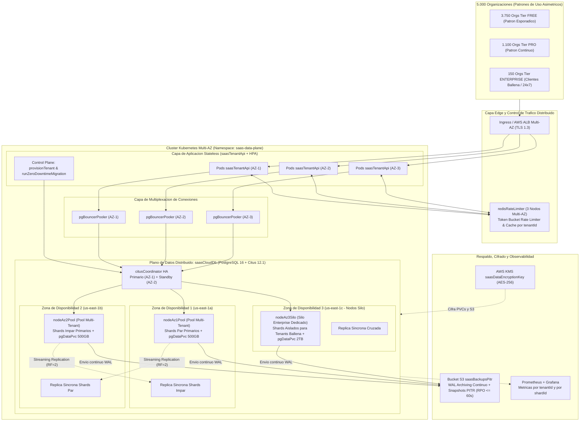
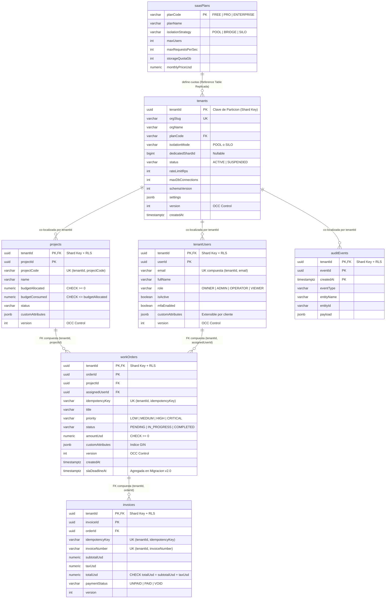

# Diagramas de Arquitectura Distribuida y Modelo de Datos (Caso 8: Cloud Native SaaS Multicliente)

Este documento presenta los diagramas técnicos de la base de datos distribuida **`saasCloudDb`** para **5.000 Organizaciones**, utilizando nomenclatura **camelCase** tanto en tablas, columnas y variables como en los componentes del clúster.

---

## 1. Diagrama de Componentes y Arquitectura Distribuida Multi-AZ (`saasCloudDb`)



---

## 2. Diagrama del Modelo de Datos Explícito en camelCase (Co-localizado por `tenantId`)

Todas las tablas operativas de **`saasCloudDb`** incluyen `tenantId` como columna de distribución y primera parte de su clave primaria compuesta ([`sql/DataModel.sql`](../sql/DataModel.sql)).



---

## 3. Diagrama de Secuencia: Protección contra *Noisy Neighbor* y Aislamiento RLS

```mermaid
sequenceDiagram
    autonumber
    participant Noisy as Tenant Ruidoso (Rafaga 500 RPS)
    participant Normal as Tenant Normal (Operacion Critica)
    participant API as Pod saasTenantApi
    participant Redis as redisRateLimiter (Token Bucket)
    participant PgB as pgBouncerPooler
    participant Citus as Nodo Worker saasCloudDb (RLS Activo)

    Noisy->>API: POST /api/v2/workOrders (Rafaga masiva)
    API->>Redis: allowRequest(noisyTenantId, rateRps=25)
    Redis-->>API: 0 tokens disponibles (Cuota agotada)
    API-->>Noisy: HTTP 429 Too Many Requests (Rechazado en < 1 ms)

    Normal->>API: POST /api/v2/workOrders (idempotencyKey: idem-9901)
    API->>Redis: allowRequest(normalTenantId, rateRps=150)
    Redis-->>API: Token concedido
    API->>PgB: Solicita conexion del Pool Transaccional
    PgB->>Citus: BEGIN; SET LOCAL ROLE saasAppRuntime; SET LOCAL app.currentTenantId = 'normalTenantId';
    Citus->>Citus: Verifica Politica RLS (tenantId == currentAppTenantId())
    Citus->>Citus: Verifica UNIQUE (tenantId, idempotencyKey) y CHECK (budgetConsumed <= budgetAllocated)
    Citus-->>PgB: COMMIT exitoso (Replica Sincrona confirmada en otra AZ)
    PgB-->>API: Resultado transaccional (latencia p95 < 8 ms)
    API-->>Normal: HTTP 201 Created
```
